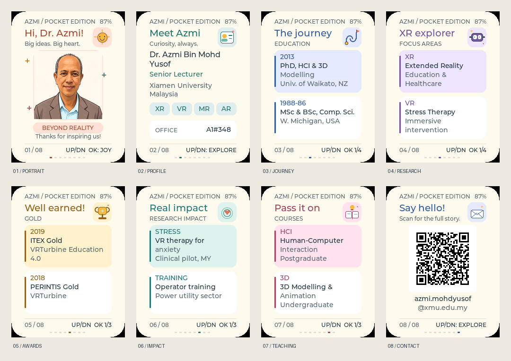

**简体中文** · [English](README.md)

# Gift for Azmi

一份送给 Dr. Azmi 老师的口袋护照，也是学生的一句感谢。用温暖的卡通肖像、
彩色学术卡片和八组小动画，记录一位老师的经历、想法和影响力。

**送给老师，也留给老师继续探索、拆解和 DIY。**
仓库包含可编辑资料、头像素材、动画源码、资源生成工具和测试。
运行设备及重新编译现有头像无需云账号、AI API Key、Wi-Fi 或订阅。



<details>
<summary>查看各章节动画</summary>


这是实际 LVGL 界面的主机渲染，并非设备照片。预览循环播放；真机进入章节后
播放约 3.2 秒，然后停稳。预览中的电量值是示例数据。

</details>

## 有哪些内容

肖像、简介、履历、研究、奖项、影响力、教学、联系：共八个章节，当前资料有
20 个视图。各章节有独立配色和动画插画：微笑太阳、探索者证件、旅程路线、
VR 眼镜、金色奖杯、爱心涟漪、知识书本、打开的信封。
联系页二维码指向示例资料中的学校个人主页。

| 按键 | 操作 |
| --- | --- |
| UP / DOWN | 上一个／下一个章节，循环切换 |
| 多视图章节中的 OK | 切换当前章节的内容子页 |
| 肖像页中的 OK | 播放庆祝动作，切换一句感谢语 |

应用离线运行，运行时只读取内置资料。在电脑上修改后，需要重新编译和刷入。
应用不录音、不连接服务器、不收集使用数据。

## 硬件

FoloToy AI Passport：**ESP32-C3、8 MB Flash、无 PSRAM、240 × 320 彩色屏幕、
三个按键**，可选 CW2017 电量计。使用 **ESP-IDF 5.5.3** 和
[dependencies.lock](dependencies.lock) 固定的依赖，包括 LVGL 9.5.0。
默认分区为 NVS、PHY data 和一个 factory 应用。其他 ESP32 板卡需要适配 BSP，
不能直接假定接线相同。

## 从这里开始

克隆或下载仓库，在已激活的 ESP-IDF 5.5.3 终端中进入项目根目录。
生成的 C 头文件已随源码提供；不修改资源直接编译，无需 Pillow 或在线图像服务。

```bash
git clone YOUR_REPOSITORY_URL gift-for-azmi
cd gift-for-azmi
idf.py --version
```

Windows：在 ESP-IDF PowerShell 终端中执行：

```powershell
.\tools\build.ps1
```

Linux / macOS：先加载 ESP-IDF 的 `export.sh`，再执行：

```bash
./tools/validate.sh --firmware
```

两种方式均从 `sdkconfig.defaults` 编译，不覆盖根目录已有的本地 `sdkconfig`；
随后校验合并镜像，并保留匹配的 ELF/MAP 调试文件。
可刷写的输出为 `build/FoloToy-AI-Passport-full.bin`。
ESP-IDF 安装和激活方法见[环境指南](docs/development/engineering/environment-setup.zh_CN.md)。

## 自己 DIY

在 Python 3.10+ 环境中安装资源生成工具的依赖：

```bash
python -m pip install -r requirements.txt
```

| 想修改…… | 改这里 |
| --- | --- |
| 姓名、职称、学校、办公室、邮箱、二维码链接 | [data/profile.json](data/profile.json) |
| 学术条目和内容子页数量 | 同一 JSON 中五组 `*Pages` 数组 |
| 头像 | 自己准备方形 PNG/JPEG，建议放在 `assets/images/` 保留复用 |
| 章节标题、配色 | [main/passport_ui.c](main/passport_ui.c) 中的 `THEMES` |
| 感谢语 | 同文件 `passport_ui_celebrate()` 中的 `messages` |
| 章节插画和逐帧动作 | [main/passport_art.c](main/passport_art.c) |
| 按键行为和页面顺序 | [main/main.c](main/main.c)、[main/passport_nav.h](main/passport_nav.h)、[main/passport_nav.c](main/passport_nav.c) |
| 板卡接线和可复用硬件逻辑 | [components/bsp](components/bsp)，从 `include/bsp_pins.h` 开始 |

修改 JSON 后，一条命令重新生成全部内置资源：

```bash
python tools/regenerate.py
```

换成自己的头像：

```bash
python tools/regenerate.py --avatar assets/images/my-portrait.png
```

图片会转换成存放于 Flash 的 144 × 144 全彩 RGB565 资源。脚本不负责将新的
照片卡通化，请提供已经画好的插画或照片。已有卡通头像可以直接重新生成，
无需再次调用图像生成服务。原始参考照片和废弃方案不随仓库分发。

每个内容子页放 **一至两条**。描述保持简短，每条在 160 px 列宽内最多折成三行。
内容更多时，在相应 `*Pages` 数组中增加子页，现有章节导航会自动使用新数量。
研究标签最多四个短词。链接过长可能需要超出现有联系页尺寸的二维码，生成工具会
明确报错；请先缩短链接或调整布局，处理完生成错误再编译。

当前字体支持可打印 ASCII。加入中文或其他文字时，请按
[字库指南](docs/development/engineering/lvgl-chinese-fonts.zh_CN.md) 补齐字形并真机检查；
UTF-8 编码本身不提供字库。示例履历是可编辑的礼物草稿，不是权威简历，
正式使用前请自行核对和修正。

## 预览与测试

首次 IDF 配置／编译下载好 Managed Components 后，使用 CMake 和桌面 C 编译器
构建实际 LVGL 主机渲染器：

```bash
cmake -S tests/ui_preview -B build/ui-host
cmake --build build/ui-host
python tools/simulate.py
```

Windows 使用 MinGW 和 Ninja 时，如果 CMake 找不到编译器，可在配置命令后加
`-G Ninja -DCMAKE_C_COMPILER=gcc`。渲染器检查文字排版、各章节动画帧变化、
500 次快速切页、动画回收和内存稳定性，并生成
`build/preview-v3/overview.png` 与 `build/preview-v3/sections.gif`。
重新生成 C 头文件后，也要重新编译主机渲染器。

Linux/macOS 的仓库与主机测试入口：

```bash
./tools/validate.sh --static
./tools/validate.sh
```

完整检查还需要已激活的 ESP-IDF。可选软件二维码解码：安装
`requirements-preview.txt`，运行 `python tools/verify_qr.py`。
GitHub Actions 会在推送 `main` 后执行静态测试和已校验固件构建。
继承的上游同步任务已禁用，避免把礼物应用替换回原始硬件测试 demo。

## 刷入设备

连接 USB 数据线，查询自己的串口。**COM8 只是最初开发电脑的串口，不是项目固定配置。**
刷写前关闭其他串口监视器：

```bash
python -m serial.tools.list_ports
python -m esptool --chip esp32c3 -p YOUR_PORT -b 460800 write_flash 0x0 build/FoloToy-AI-Passport-full.bin
```

合并后的 `full.bin` 从 **0x0** 写入，只有应用的 `.bin` 不能写到这个地址。
合并刷写可能重置 NVS／设置，不要把整片擦除当成日常步骤。详见
[固件布局和数据保留说明](docs/development/engineering/firmware-layout.zh_CN.md)。
刷写后检查头像颜色、所有章节、上下翻页、OK 庆祝动作、动画流畅度及手机扫码。
刷写成功本身不代表屏幕和实体按键已经验收通过。

## 文件导览

```text
data/                 可编辑资料、缓存的字体宽度数据
assets/images/        最终可复用头像与创建提示词
assets/screenshots/   README 预览
main/passport_*.c     应用界面、导航和章节动画
components/bsp/       板级驱动和公开硬件接口
tools/                资源生成、预览、验证和打包工具
tests/                主机测试和真实 LVGL 预览程序
docs/                 保留的硬件及工程参考文档
skills/               可选的 AI 辅助开发工作流
```

`main/demo_*.c` 和对应测试保留作硬件参考，不会编译进当前应用。
构建输出、本机工具链、原始串口日志、凭据、Python 缓存和无用实验不进入仓库。

## 许可与致谢

源码以 [MIT 许可证](LICENSE) 开源。本项目基于
[FoloToy/ai-passport](https://github.com/FoloToy/ai-passport)，保留原版权声明和工程参考文档。
ESP-IDF 及 Managed Components 各自保留其许可证。

卡通头像根据制作礼物时提供的参考照片由 AI 生成。仓库提供提示词和最终插画，
不提供原始照片。代码许可证不代表获得他人姓名、肖像或学校品牌的使用授权；
制作其他人的护照时，请换成自己的头像和资料。
学术资料来源：[Dr. Azmi 的学校个人主页](https://www.xmu.edu.my/staff/dr-azmi-bin-mohd-yusof)。

2026-10-21 本地验证：固件构建、静态／主机检查、合并镜像与 ELF 身份校验、
USB 刷写和启动日志均通过。实际颜色、帧率、按键手感及手机扫码仍需使用者观察。
